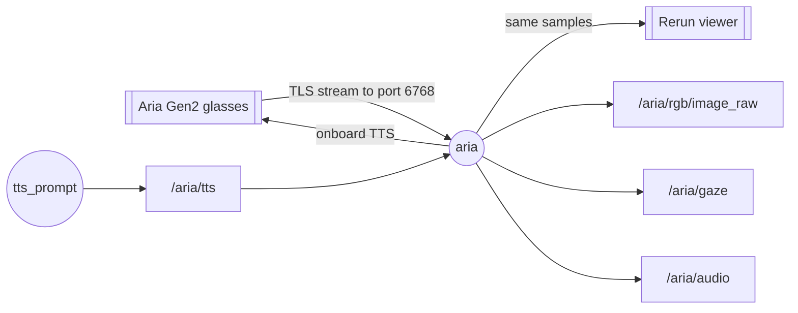

# aria2_ros2

A ROS 2 Humble workspace for Project Aria Gen2 glasses. Its `aria` node publishes the glasses'
ego video, eye gaze and microphones while streaming is on, and speaks text from `/aria/tts`
through the glasses' onboard TTS. Streaming runs over the LAN by default. Meta's Rerun viewer,
the one `aria_streaming_viewer` opens, shows the same streams with the gaze drawn on the video.

## System



Circles are ROS nodes, boxes are topics, and double boxes are the glasses and the viewer. The
glasses stream to one receiver, so the viewer runs inside the aria node rather than beside it.

| Name | Type | Content |
| --- | --- | --- |
| `/aria/rgb/image_raw` | `sensor_msgs/Image` | ego video, rgb8 |
| `/aria/gaze` | `geometry_msgs/PointStamped` | where the wearer looks, metres in frame `aria_cpf` |
| `/aria/audio` | `aria_msgs/Audio` | microphone blocks, interleaved int32 |
| `/aria/tts` | `std_msgs/String` | subscribed: text the glasses speak, one utterance per message |
| `/aria/set_streaming` | `std_srvs/SetBool` | service: start or stop streaming |

Header stamps are host times of capture: arrival time minus the TicSync transport latency once the
glasses' and host's clocks sync, arrival time before that.

## Layout

```text
aria2_ros2/                       colcon workspace
├── setup_env.sh                  makes .venv, adds the Aria SDK and Rerun, builds
├── activate.sh                   sources ROS 2, .venv and install/
├── requirements.txt              pip packages outside rosdep
├── src/
│   ├── aria_msgs/msg/Audio.msg
│   └── aria_driver/
│       ├── config/aria.yaml      every setting of a run
│       ├── launch/aria.launch.py the aria node
│       ├── aria_driver/
│       │   ├── aria_node.py      the aria node and its Rerun viewer
│       │   ├── glasses.py        Client SDK: connect, stream, record, TTS
│       │   ├── messages.py       Aria samples to ROS messages
│       │   ├── session.py        one folder per streaming session
│       │   ├── clock.py          capture clock to host clock, offline
│       │   ├── config.py         settings as a frozen addict Dict
│       │   ├── to_mp4.py         session VRS recordings to MP4
│       │   ├── tts_prompt.py     terminal lines to /aria/tts
│       │   └── device_cli.py     aria_device: status, profiles, recordings
│       └── test/
└── data/
    ├── sessions/                 one folder per streaming session
    ├── videos/                   MP4 files from to_mp4
    └── downloads/                recordings from aria_device download
```

## Run

1. Install ROS 2 Humble and [uv](https://docs.astral.sh/uv/).

2. Build the workspace once, then source it in every terminal:

   ```bash
   ./setup_env.sh
   source activate.sh
   ```

   `ARIA_VENV=<path>` points both scripts at another venv. `activate.sh` puts the workspace on
   ROS domain 42, apart from other ROS 2 projects; `ARIA_ROS_DOMAIN_ID=<id>` joins theirs.

3. Connect the glasses over USB with developer mode on, and check them:

   ```bash
   ros2 run aria_driver aria_device info
   ```

4. Let the glasses reach the receiver. They open a TLS connection to this host on port 6768
   with a streaming certificate, installed once on the glasses and in `~/.aria/streaming-certs`.
   The host's firewall accepts it. For `wifi_sta` the glasses join a Wi-Fi network this host is
   on; a lab network without internet needs `--skip-internet-check`:

   ```bash
   aria_gen2 streaming install-certs
   sudo ufw allow in on aria_gen2 to any port 6768 proto tcp   # usb
   sudo ufw allow 6768/tcp                                     # wifi_sta and wifi_sap
   aria_gen2 device wifi connect --ssid sparklab24 --password <check-the-black-router> --skip-internet-check
   ```

   With `device.ip` empty the node finds the glasses over USB, then for Wi-Fi streaming controls
   them over Wi-Fi, which takes up to 20 s; the cable comes off once streaming starts. Setting
   `device.ip` to their Wi-Fi address starts without the cable.

5. Start the aria node. The Rerun viewer opens with the ego video, gaze and audio:

   ```bash
   ros2 launch aria_driver aria.launch.py
   ```

   Run settings live in `src/aria_driver/config/aria.yaml`, and a copy runs with
   `config:=$PWD/my_aria.yaml`. One key changes with
   `ros2 run aria_driver aria_node --ros-args --params-file src/aria_driver/config/aria.yaml -p stream.interface:=usb`.
   `viewer.enable:=false` runs without the viewer, for example on a headless machine.

6. Check the topics:

   ```bash
   ros2 topic hz /aria/rgb/image_raw
   ros2 topic echo /aria/gaze
   ```

7. Speak through the glasses from a terminal:

   ```bash
   ros2 run aria_driver tts_prompt
   ros2 topic pub --once /aria/tts std_msgs/msg/String "{data: 'Hello from ROS'}"
   ```

8. Stop and restart streaming without restarting the node:

   ```bash
   ros2 service call /aria/set_streaming std_srvs/srv/SetBool "{data: false}"
   ```

9. Find the results. Each streaming session writes a new folder `data/sessions/<UTC time>_<id>/`
   under the launch directory and never reuses one. `record.enable:=false` streams without saving.

   - `config.yaml`: the run's settings, a parameter file that starts the same run
   - `vrs/<time>.vrs`: every stream as received, one file per connection of the glasses
   - `clock.csv`: capture time, arrival time and TicSync latency of each sample

   Device capture times in the VRS map to host time with

   ```python
   from aria_driver.clock import ClockFit

   fit = ClockFit('data/sessions/<session>/clock.csv', 'rgb')
   host_ns = fit.map(capture_ns)
   ```

10. Watch a session. Once its streaming has stopped, this converts its recordings to MP4 in
    `data/videos/`, the newest session unless `--session` names one, and keeps MP4 files that
    already exist. It needs `sudo apt install ffmpeg` once:

    ```bash
    ros2 run aria_driver to_mp4
    ros2 run aria_driver to_mp4 --session <UTC time>_<id>
    ```

## Glasses tools

```bash
ros2 run aria_driver aria_device profiles
ros2 run aria_driver aria_device recordings
ros2 run aria_driver aria_device record --name trial_001 --seconds 20
ros2 run aria_driver aria_device download <uuid> --output data/downloads
```

Each command reads the `device` block of the same parameter file and takes `key=value` overrides,
such as `device.ip=192.168.1.20`.

## Tests

```bash
python -m colcon test --packages-select aria_driver
python -m colcon test-result --verbose
```
